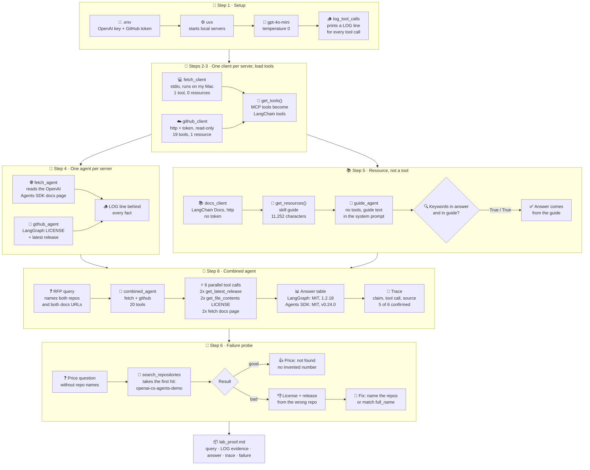

# Lab Proof: Agents that Speak MCP Fluently

**Ayhan Demir** · Ironhack AI Consulting & Integration Bootcamp · Module 4, Week 4 · Run date: 2026-10-28

## 1. What I built

An agent that helps a consultant **shortlist agent frameworks for a client RFP**: LangGraph vs the OpenAI Agents SDK. It must answer with facts from sources, not from memory. Code: [`mcp_langchain.ipynb`](mcp_langchain.ipynb) (Steps 1 to 6 of the brief; optional Steps 7 and 8 not done).

| MCP server | Transport | Client | What it gives the agent |
|---|---|---|---|
| **Fetch** (`mcp-server-fetch@2026.10.24`, runs on my Mac) | stdio, started with `uvx` | `fetch_client`, 1 tool | The documentation page of each framework |
| **GitHub** (official, `https://api.githubcopilot.com/mcp/`) | http, token in the headers, toolsets `repos,issues`, read-only | `github_client`, 19 tools | License (`LICENSE` file) and latest release of each repo |
| **LangChain Docs** (`https://docs.langchain.com/mcp`) | http, no token | `docs_client`, Step 5 only | The LangChain skill guide as a **resource** (11,252 characters) |

How the notebook works:
### Process map (end to end)

From setup to this proof, with the results of my run. Boxes are notebook steps and their results; diamonds are checks.



| Step | What happens | Result in my run |
|---|---|---|
| 1 Setup | Load keys, find `uvx`, create `gpt-4o-mini` (temperature 0) and the `[LOG]` evidence interceptor | Key, `uvx` and token found |
| 2 Connect | One client per server, each with the interceptor; count tools and resources | Fetch: 1 tool, 0 resources. GitHub: 19 tools, 1 resource |
| 3 Load tools | `get_tools()` turns MCP tools into LangChain tools | `fetch` + 19 read-only GitHub tools |
| 4 One agent per server | Fetch agent reads the OpenAI Agents SDK docs; GitHub agent reads LangGraph's LICENSE and latest release | Both answered with `[LOG]` lines behind every fact |
| 5 Resource | The guide text goes into the system prompt of an agent with **no tools** | Key words "deterministic" and "human-in-the-loop" are in the answer **and** in the guide |
| 6 Combined agent | `fetch_tools + github_tools` (20 tools) in one agent; the RFP query below; plus a failure probe | 6 tool calls across both servers; one table with sources |

## 2. Query

> We are shortlisting agent frameworks for a client RFP. For LangGraph (GitHub repo langchain-ai/langgraph, docs https://docs.langchain.com/oss/python/langgraph/overview) and the OpenAI Agents SDK (GitHub repo openai/openai-agents-python, docs https://openai.github.io/openai-agents-python/): give each one's license and latest release from GitHub, and one sentence from each docs page on what the framework is for. Answer as a small table with a source column.

## 3. Evidence

The `[LOG]` lines from the interceptor (Step 6). The agent sent all 6 tool calls at once, so the `returned` lines arrive in the order the servers answered, not the order of the calls. Each one is matched to its call by the repo or URL in the text.

```text
[LOG] github -> get_latest_release  {'owner': 'langchain-ai', 'repo': 'langgraph'}
[LOG] github -> get_latest_release  {'owner': 'openai', 'repo': 'openai-agents-python'}
[LOG] github -> get_file_contents  {'owner': 'langchain-ai', 'repo': 'langgraph', 'path': 'LICENSE'}
[LOG] github -> get_file_contents  {'owner': 'openai', 'repo': 'openai-agents-python', 'path': 'LICENSE'}
[LOG] fetch -> fetch  {'url': 'https://docs.langchain.com/oss/python/langgraph/overview'}
[LOG] fetch -> fetch  {'url': 'https://openai.github.io/openai-agents-python/'}
[LOG]    returned: Contents of https://openai.github.io/openai-agents-python/:
<p>OpenAI Agents SDK</p>

Skip to content

# OpenAI Agents SDK

The OpenAI Agents SDK enab...
[LOG]    returned: Contents of https://docs.langchain.com/oss/python/langgraph/overview:
<p>LangGraph overview - Docs by LangChain</p>

> ## Documentation Index
>
> Fetc...
[LOG]    returned: {"tag_name":"v0.24.0","target_commitish":"17d994bd3045dae71acda676a4ef4762ed8ecd94","name":"v0.24.0","body":"## [0.24.0](https://github.com/openai/ope...
[LOG]    returned: {"tag_name":"1.2.18","target_commitish":"3521f08e21a7d89c28331191374bc85c11ecb6e2","name":"langgraph==1.2.18","body":"Changes since 1.2.17\n\n* releas...
[LOG]    returned: successfully downloaded text file (SHA: fc0602feecdd6748623c852ab534e1ca612673c7) type='resource' resource=TextResourceContents(uri=AnyUrl('repo://lan...
[LOG]    returned: successfully downloaded text file (SHA: e5ad2c5aa30343f143a5c418004ca1a8d2cfaff4) type='resource' resource=TextResourceContents(uri=AnyUrl('repo://ope...
```

## 4. Final answer

| Framework | License | Latest Release | Description | Source |
|---|---|---|---|---|
| LangGraph | MIT License | [1.2.18](https://github.com/langchain-ai/langgraph/releases/tag/1.2.18) | LangGraph is a low-level orchestration framework for building, managing, and deploying long-running, stateful agents. | [LangGraph Docs](https://docs.langchain.com/oss/python/langgraph/overview) |
| OpenAI Agents SDK | MIT License | [v0.24.0](https://github.com/openai/openai-agents-python/releases/tag/v0.24.0) | The OpenAI Agents SDK enables you to build agentic AI apps in a lightweight, easy-to-use package with very few abstractions. | [OpenAI Agents SDK Docs](https://openai.github.io/openai-agents-python/) |

## 5. Trace

Which claim comes from which tool call. The interceptor shows only the first 150 characters of each result, so where the fact sits further down, I checked it at the source itself.

| Claim in the answer | Tool call | Visible in the `[LOG]` line? | Checked at the source |
|---|---|---|---|
| LangGraph latest release: 1.2.18 | `github -> get_latest_release` (langchain-ai/langgraph) | **Yes**: `"tag_name":"1.2.18"`, `"name":"langgraph==1.2.18"` | Matches |
| OpenAI Agents SDK latest release: v0.24.0 | `github -> get_latest_release` (openai/openai-agents-python) | **Yes**: `"tag_name":"v0.24.0"` | Matches |
| LangGraph license: MIT | `github -> get_file_contents` (LICENSE, SHA fc0602f...) | Partly: the file was downloaded, its text is cut | `LICENSE` starts with "MIT License": matches |
| OpenAI Agents SDK license: MIT | `github -> get_file_contents` (LICENSE, SHA e5ad2c5...) | Partly: the file was downloaded, its text is cut | `LICENSE` starts with "MIT License": matches |
| OpenAI Agents SDK: "enables you to build agentic AI apps in a lightweight..." | `fetch -> fetch` (openai.github.io/openai-agents-python) | **Yes**, the start: "The OpenAI Agents SDK enab..." | The page opens with "The OpenAI Agents SDK enables you to build agentic AI apps in a lightweight, ...": matches |
| LangGraph: "a low-level orchestration framework for building, managing, and deploying long-running, stateful agents" | `fetch -> fetch` (docs.langchain.com/.../overview) | No: the preview stops at the page's index header | The same sentence is in the LangGraph README on GitHub, so it is genuine; the log alone does not prove it came from the docs page |

Resource (Step 5) has no tool call, so the evidence is a keyword check. Answer: *"...when they need to orchestrate complex workflows that mix deterministic logic with LLM-driven steps in a single graph. LangGraph provides low-level control for such scenarios, allowing for human-in-the-loop processes."*

```text
'deterministic': in answer = True, in guide = True
'human-in-the-loop': in answer = True, in guide = True
```

**Grounding verdict:** every fact in the final answer has a tool call behind it. 5 of 6 are confirmed in the tool output or at the same source; the LangGraph sentence is genuine but not visible in the log preview. No fact was added from memory.

## 6. Failure or limitation

**Where could the system produce a plausible but unsupported answer? My failure probe showed it.**

I asked a question **without** repo names: *"Does LangGraph or the OpenAI Agents SDK offer paid enterprise support, and what does it cost per year? Use only your tools."*

```text
[LOG] github -> search_repositories  {'query': 'OpenAI Agents SDK'}
[LOG]    returned: {"total_count":3595,...,"items":[{"id":1001787804,"name":"openai-cs-agents-demo","full_name":"openai/openai-cs-agents-demo",...
[LOG] fetch -> fetch  {'url': 'https://github.com/openai/openai-cs-agents-demo'}
[LOG] github -> get_file_contents  {'owner': 'openai', 'repo': 'openai-cs-agents-demo', 'path': 'LICENSE'}
[LOG] github -> get_latest_release  {'owner': 'openai', 'repo': 'openai-cs-agents-demo'}
[LOG]    returned: failed to get latest release: ... openai-cs-agents-demo/releases/latest: 404 Not Found
```

| What happened | Good or bad |
|---|---|
| Price: *"Enterprise Support: Not found in the sources"* for both | **Good.** No invented number, the "never guess" rule worked |
| The agent took the **first search hit**, `openai/openai-cs-agents-demo` (a customer-service demo), as "the OpenAI Agents SDK" | **Bad.** Wrong entity |
| It reported *"License: MIT License (source: LICENSE file, openai-cs-agents-demo)"* | **Plausible but unsupported**: MIT happens to be right, but the evidence is from the wrong repo |
| It reported *"Latest Release: Not found in the sources"* | **Wrong**: the real SDK has v0.24.0 (Step 6). The 404 came from the demo repo |

**Lesson:** a tool call is not enough. Grounding also means **the right source**: every answer had a `[LOG]` line, yet two facts were tied to the wrong repository. The `[LOG]` trace is what made this visible. **Fix:** name the exact repos in the question (as in the main query), or add a prompt rule "only use repositories whose `full_name` matches the one asked for".

**Other limitations**
- **The log preview is short.** 150 characters hid the license text and the LangGraph sentence (section 5). A reviewer must open the source to check those facts.
- **Long pages are cut.** Fetch returns 5,000 characters per call. In Step 4 the agent fetched the SDK page a second time with `start_index: 5000` to read on, which worked here but depends on the model.
- **One run, temperature 0.** That does not fix which tools the agent picks; a second run can take a different path.
